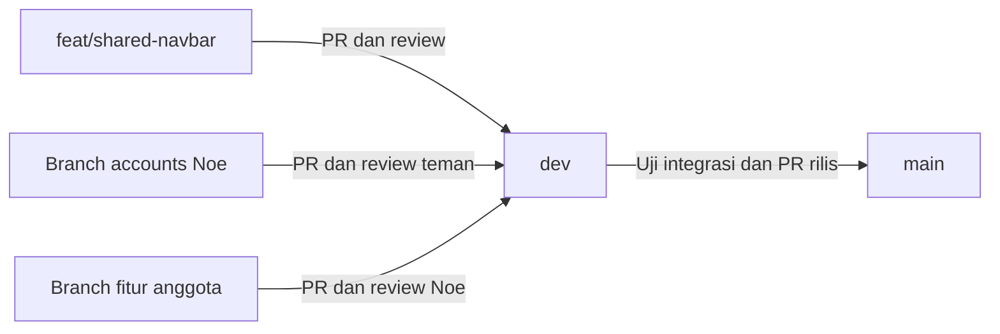

# Alur PR RePair untuk Noe sebagai lead

Repository: [Kel-2-PBP-C/RePair](https://github.com/Kel-2-PBP-C/RePair). Anggota mengirim perubahan ke branch fitur masing-masing, lalu membuka PR ke `dev`. Noe memeriksa dan menggabungkan PR satu per satu. Setelah integrasi selesai dan diuji, buka satu PR dari `dev` ke `main`. Perintah di panduan ini untuk kamu jalankan; penulisan panduan tidak melakukan push, membuat PR, atau merge di GitHub.

Pekerjaan yang sudah disiapkan secara lokal:

| Bagian | Lokasi/branch | Kondisi |
| --- | --- | --- |
| Navbar bersama | `C:\Users\Noe Andrew\PBP\repair-shared-navbar`, branch `feat/shared-navbar` | Commit awal `be2d58e`, 18 file, ditambah perapihan teks pada `7ef15d5`; 8 tes core lulus |
| Ketergantungan navbar pada accounts | Branch `Halaman-Login/Register-dan-Profil-dan-Setting` | Navbar sudah di-merge lokal melalui commit `9738612`; kedua app tetap terdaftar |
| Revisi auth serta Profil & Setting | `C:\Users\Noe Andrew\PBP\re&pair` | Perubahan accounts belum di-commit agar kamu bisa meninjau sebelum commit/push |

Branch navbar dibuat dari `origin/dev` dan belum memiliki upstream sampai push pertama. Tidak ada push, PR, atau merge remote yang dijalankan. **Untuk memakai hasil yang sudah disiapkan, jangan membuat ulang branch/navbar commit.** Setelah meninjau, kamu jalankan:

```powershell
git -C 'C:\Users\Noe Andrew\PBP\repair-shared-navbar' status
git -C 'C:\Users\Noe Andrew\PBP\repair-shared-navbar' log -1 --oneline
git -C 'C:\Users\Noe Andrew\PBP\repair-shared-navbar' push -u origin feat/shared-navbar
```

Buka PR navbar **base: dev**, **compare: feat/shared-navbar**, minta review teman, lalu merge PR itu terlebih dahulu. Push pertama navbar dengan `-u` menetapkan upstream untuk push berikutnya.

**Setelah PR navbar sudah masuk dev**, tinjau dan commit revisi accounts, lalu sinkronkan dev serta push branch Noe. Urutan commit lebih dahulu menjaga perubahan accounts saat kamu berpindah ke dev:

```powershell
Set-Location 'C:\Users\Noe Andrew\PBP\re&pair'
git branch --show-current
git diff
git add accounts RePair/settings.py RePair/urls.py README.md docs/MODULE_1_WORKFLOW.md docs/TEAM_PR_WORKFLOW.md
git diff --cached
git commit -m "feat(accounts): aktifkan auth serta gabungkan profil dan setting"
git status
git checkout dev
git pull --ff-only origin dev
git checkout "Halaman-Login/Register-dan-Profil-dan-Setting"
git merge dev
git push -u origin "Halaman-Login/Register-dan-Profil-dan-Setting"
```

Pada pemeriksaan pertama, branch aktif harus branch accounts Noe. Sesudah commit, pastikan working tree bersih sebelum checkout dev. Jika merge menghasilkan konflik, selesaikan sesuai langkah 6 sebelum push. Kemudian buka PR accounts **base: dev**, **compare: Halaman-Login/Register-dan-Profil-dan-Setting** dan minta review teman. Diff-nya sekarang menampilkan revisi accounts; navbar sudah terdapat pada base dev.



| PR | Base, yaitu tujuan | Compare, yaitu sumber |
| --- | --- | --- |
| Navbar bersama | `dev` | `feat/shared-navbar` |
| Modul Noe | `dev` | `Halaman-Login/Register-dan-Profil-dan-Setting` |
| Modul anggota lain | `dev` | Branch fitur anggota tersebut |
| Rilis seluruh modul | `main` | `dev` |

`git push` mengirim commit ke branch di GitHub. PR mengusulkan penggabungan branch. Merge yang kamu konfirmasi di GitHub memperbarui branch tujuan di GitHub; branch lokalmu baru mengikuti hasilnya setelah pull. Untuk pekerjaan biasa, push hanya ke branch fitur, kemudian merge melalui PR. [Arti base/compare dan cara membuat PR](https://docs.github.com/en/pull-requests/how-tos/create-pull-requests/creating-a-pull-request).

1. **Sepakati aturan repository sekali di awal.**

   Pastikan Noe memiliki izin `Write` atau lebih tinggi untuk merge. Pengaturan repository memerlukan `Admin` atau izin pengaturan aturan yang sesuai; jika kamu belum punya, minta owner organisasi mengaturnya.

   Di **Settings → General → Pull Requests**, aktifkan **Allow merge commits**, kemudian matikan **Automatically delete head branches**. Sesudah merge, pertahankan semua branch fitur dan `dev`; jangan menekan **Delete branch**. [Pengaturan hapus branch otomatis](https://docs.github.com/en/repositories/configuring-branches-and-merges-in-your-repository/configuring-pull-request-merges/managing-the-automatic-deletion-of-branches).

   Rekomendasi tim ini: gunakan **Create a merge commit** untuk PR fitur ke `dev` dan PR `dev` ke `main`. Cara ini menyimpan commit masing-masing anggota dan hubungan antarbranch. Ini cocok karena branch fitur akan dipakai lagi. Squash pada branch yang terus digunakan bisa membuat PR berikutnya kembali menampilkan commit yang sebelumnya sudah digabung. [Perbandingan cara merge](https://docs.github.com/en/pull-requests/reference/pull-request-merges).

   Jika paket GitHub repository mendukungnya, tambahkan ruleset atau branch protection untuk `dev` dan `main`: wajib PR, minimal satu approving review, semua percakapan terselesaikan, dan status check CI yang memang sudah ada harus lulus. Blokir force push dan penghapusan dua branch itu. Jangan mewajibkan linear history karena tim memilih merge commit. Kalau CI belum dibuat, jangan pilih check yang belum ada; catat hasil pengecekan lokal di PR dulu. [Aturan yang tersedia](https://docs.github.com/en/repositories/configuring-branches-and-merges-in-your-repository/managing-rulesets/available-rules-for-rulesets).

   Branch protection dan ruleset tersedia untuk repository publik pada GitHub Free. Repository privat milik organisasi memerlukan paket yang mendukung, seperti GitHub Team; jangan berasumsi GitHub Free organisasi menyediakan aturan tersebut untuk repository privat. Jika belum tersedia, jalankan kesepakatan review secara manual. [Ketersediaan branch protection](https://docs.github.com/en/repositories/configuring-branches-and-merges-in-your-repository/managing-protected-branches/about-protected-branches), [ketersediaan ruleset](https://docs.github.com/en/repositories/configuring-branches-and-merges-in-your-repository/managing-rulesets/about-rulesets).

2. **Pisahkan navbar bersama dari branch modul accounts.**

   Gunakan branch `feat/shared-navbar` dari `dev`, karena navbar dipakai semua app. Branch Noe tetap khusus app `accounts`. Jangan membuat branch navbar dari branch accounts: PR navbar bisa ikut membawa semua perubahan accounts.

   Struktur bersama yang disarankan:

   ```text
   templates/base.html
   templates/components/navbar.html
   static/css/site.css
   core/
   ```

   `base.html` menyediakan kerangka dan blok konten. Navbar disertakan dari base; setiap app cukup membuat halaman yang extends base itu. CSS khusus accounts tetap di `accounts/static/accounts/`. Noe mengurus komponen bersama dan perubahan pengaturan template/static, sedangkan anggota mengurus template dan URL app mereka. Sepakati perubahan pada `RePair/settings.py`, `RePair/urls.py`, dan base template agar perubahan satu anggota tidak menghapus app atau route anggota lain.

   Menu navbar: Beranda, Keranjang, Post Saya, serta Profil & Pengaturan. Beranda membuka landing/barter milik Aisha, sehingga tidak ada menu Barter terpisah. Gunakan named URL Django ketika route modul sudah tersedia. Untuk modul yang belum digabung, tampilkan menu belum aktif; jangan membuat tautan menuju route yang belum ada. Layar auth mengganti navbar utama dengan header merek minimal. Layar Profil & Setting memakai navbar utama bersama.

   Alur modul Noe adalah `/` → auth `/accounts/auth/?mode=login` atau `/accounts/auth/?mode=register` → `/landing/` → Profil & Setting `/accounts/profile/` melalui navbar. Login dan register berfungsi; root mengarahkan pengguna yang sudah login langsung ke landing. App `core` menyediakan landing sementara agar alur bisa dicoba sebelum modul Aisha masuk. Named URL `core:landing` tetap mengarah ke `/landing/`; URL lama accounts diarahkan ke layar gabungan yang sesuai.

   Saat modul Aisha diintegrasikan, branch `main-page` memiliki app `main_page` dengan named URL `main_page:show_main` pada path kosong. Ubah route landing pada `core/urls.py` agar memakai `show_main` milik Aisha, lalu mount `main_page.urls` pada `/landing/` sesudah include core. Ini mempertahankan `core:landing` dan `main_page:show_main` pada URL `/landing/` yang sama, sedangkan `/` tetap menjadi gerbang auth:

   ```python
   # core/urls.py pada PR integrasi landing
   from django.urls import path
   from main_page.views import show_main

   app_name = "core"
   urlpatterns = [path("landing/", show_main, name="landing")]

   # RePair/urls.py: pertahankan route accounts dan entry point root
   path("", include("core.urls")),
   path("landing/", include("main_page.urls")),
   ```

   View `show_main` **wajib memeriksa login**, misalnya memakai `@login_required`, karena view itu menggantikan landing core yang sebelumnya menjalankan pemeriksaan autentikasi. Uji akses langsung `/landing/` saat logout: pengguna harus diarahkan ke auth. Ikuti juga [panduan integrasi navbar](NAVBAR_INTEGRATION.md). Menu Keranjang mengikuti route `/keranjang/` dengan nama URL `keranjang`. Untuk detail barter dan daftar post, pakai nama route aktual anggota ketika modulnya masuk.

   **Navbar sudah dipersiapkan di worktree tersendiri dari `origin/dev`.** Worktree memberi folder kerja terpisah sehingga kamu tidak perlu mengganti branch folder accounts. Kamu cukup menjalankan perintah push pada awal panduan. Pola berikut merupakan referensi bila membuat branch bersama lain pada masa mendatang; jangan dijalankan lagi untuk navbar yang sudah tersedia:

   ```powershell
   Set-Location 'C:\Users\Noe Andrew\PBP\re&pair'
   git status
   git fetch origin
   git worktree add -b feat/shared-navbar '..\repair-shared-navbar' origin/dev
   Set-Location '..\repair-shared-navbar'
   git branch --show-current
   ```

   Pada penyiapan awal, perintah terakhir menampilkan `feat/shared-navbar`. Tambahkan navbar, base, asset bersama, dan pengaturan yang dibutuhkan di folder baru itu. Tinjau diff lalu commit file navbar saja. Langkah commit ini sudah dilakukan pada hasil sekarang; berikut contoh alurnya untuk referensi:

   ```powershell
   git diff
   git add core templates static RePair/settings.py RePair/urls.py
   git diff --cached
   git commit -m "feat(ui): tambah base template dan navbar bersama"
   git push -u origin feat/shared-navbar
   ```

   Sesuaikan daftar `git add` dengan file yang benar-benar diubah; jangan memasukkan file module accounts. Buka PR navbar dengan base `dev`, compare `feat/shared-navbar`, dan minta anggota lain review karena kamu penulisnya. Folder worktree accounts tetap di `C:\Users\Noe Andrew\PBP\re&pair`; folder navbar berada di `C:\Users\Noe Andrew\PBP\repair-shared-navbar`.

   Agar halaman accounts bisa langsung memakai base/navbar, branch navbar yang sudah di-commit lokal telah di-merge ke branch accounts sebagai ketergantungan lokal, melalui commit `9738612`. Konflik pada pendaftaran app dan URL sudah diselesaikan dengan mempertahankan accounts serta core. Ini tidak menggabungkan apa pun ke `dev` di GitHub. Karena itu, **merge PR navbar ke dev lebih dahulu**, baru buka/merge PR accounts. Setelah navbar masuk dev, perubahan bersama sudah menjadi bagian base sehingga diff PR accounts berfokus pada accounts. Sebelum itu, diff accounts terhadap dev masih bisa menampilkan file navbar.

3. **Masing-masing anggota menyinkronkan dev, bekerja, lalu mengirim PR.**

   Sebelum pindah branch, jalankan `git status`. Jika ada pekerjaan yang belum disimpan di Git, selesaikan dan commit file yang relevan di branch fitur sendiri. Jangan memindahkan perubahan setengah jadi ke `dev`. Setelah working tree bersih:

   ```powershell
   git fetch origin
   git checkout dev
   git pull --ff-only origin dev
   git checkout "Halaman-Login/Register-dan-Profil-dan-Setting"
   git merge dev
   ```

   Jika belum ada branch `dev` lokal, gunakan `git checkout -b dev --track origin/dev` menggantikan `git checkout dev` sekali saja. `git pull --ff-only origin dev` adalah bentuk lebih ketat dari saran asdos `git pull origin dev`: hanya memperbarui local dev jika bisa maju langsung. Jika gagal karena branch lokal divergen, periksa commit lokal; jangan langsung force push atau reset.

   Setelah mengerjakan modul dan memeriksa perubahan:

   ```powershell
   git diff
   git add accounts RePair/settings.py RePair/urls.py README.md docs/MODULE_1_WORKFLOW.md docs/TEAM_PR_WORKFLOW.md
   git diff --cached
   git commit -m "feat(accounts): aktifkan auth serta gabungkan profil dan setting"
   git push -u origin "Halaman-Login/Register-dan-Profil-dan-Setting"
   ```

   Daftar file merupakan contoh untuk modul Noe; stage hanya file yang benar-benar menjadi bagian PR. Anggota lain mengganti nama branch dan file sesuai app mereka. Jangan mengirim `.env`, folder virtual environment, atau database lokal.

   Di GitHub buka repository → **Pull requests → New pull request**. Pilih **base: dev**, **compare: branch fitur anggota**, cek daftar perubahan, isi judul serta deskripsi. Sebutkan halaman/fitur yang ditambahkan, langkah mengujinya, hasil tes, dan keterbatasan checkpoint. Klik **Create pull request**, lalu pilih Noe sebagai reviewer. Jika masih dikerjakan, gunakan Draft dan ubah menjadi Ready for review setelah siap. Noe juga dapat membuka PR dari branch anggota yang sudah di-push dalam repository yang sama; tetap pilih compare branch anggota tersebut. Namun, sebagai pembuka PR, Noe perlu meminta approval teman lain karena penulis PR tidak bisa approve PR sendiri. Supaya pembagian tanggung jawab jelas, anggota sebaiknya membuka PR mereka dan Noe menangani review serta merge. [Langkah membuat PR](https://docs.github.com/en/pull-requests/how-tos/create-pull-requests/creating-a-pull-request).

4. **Noe memeriksa setiap PR sebelum merge.**

   Buka PR dan periksa tujuan masih `dev`. Baca deskripsi, buka **Commits** untuk memahami perubahan, lalu **Files changed** untuk membaca diff. Pastikan satu PR berfokus pada modulnya, tidak menghapus kontribusi anggota lain, dan app-nya didaftarkan dengan benar. Perhatikan URL, template bersama, dependencies, migrasi, dan perubahan settings karena file tersebut memengaruhi seluruh project.

   Periksa **Checks** atau bagian status di bawah percakapan. Semua check yang diwajibkan harus lulus; jika tidak ada CI, minta bukti pemeriksaan lokal. Coba halaman normal, validasi form, perpindahan antarhalaman, dan navbar di lebar layar kecil. Khusus accounts, uji registrasi, login salah/benar, logout, redirect guest, edit profil, simpan preferensi, ubah password, dan penonaktifan akun. Pastikan ubah password mempertahankan sesi dan pengguna yang belum login tidak dapat langsung membuka landing maupun profil.

   Pada **Files changed**, tambahkan komentar di baris yang perlu diperbaiki dan tandai file sebagai **Viewed** setelah diperiksa. Klik **Review changes**: pilih **Request changes** jika ada masalah, **Comment** untuk saran umum, atau **Approve** jika siap. Klik **Submit review**. Setelah penulis push perbaikan ke branch yang sama, PR otomatis diperbarui; cek kembali bagian yang berubah. [Cara melakukan review](https://docs.github.com/en/pull-requests/how-tos/review-pull-requests/reviewing-proposed-changes-in-a-pull-request).

   Untuk PR yang **kamu tulis sendiri**, minta satu anggota lain review dan approve. Penulis tidak dapat approve PR sendiri. Kamu tetap boleh menjalankan merge setelah persyaratan terpenuhi dan memiliki izin yang sesuai. Ini berlaku untuk PR accounts, navbar, dan PR rilis `dev` ke `main` yang kamu buka. [Aturan approving review](https://docs.github.com/en/pull-requests/how-tos/review-pull-requests/approving-a-pull-request-with-required-reviews).

5. **Uji PR lokal di folder terpisah agar pekerjaan accounts aman.**

   Contoh untuk PR nomor `12`. Ganti angka itu dengan nomor PR aktual dan pilih nama/folder baru setiap kali:

   ```powershell
   Set-Location 'C:\Users\Noe Andrew\PBP\re&pair'
   git fetch origin
   git fetch origin pull/12/head:review/pr-12
   git worktree add '..\repair-review-pr-12' review/pr-12
   Set-Location '..\repair-review-pr-12'
   git merge origin/dev --no-edit
   ```

   Merge di folder review ini hanya untuk mencoba gabungan fitur dengan `dev` terbaru, bukan merge remote. Jika ada konflik, hentikan uji integrasi dan minta penulis menyelesaikannya di branch fitur. GitHub menyediakan ref `pull/ID/head` untuk mengambil isi PR sebelum merge. [Mengambil PR secara lokal](https://docs.github.com/en/pull-requests/how-tos/review-pull-requests/checking-out-pull-requests-locally).

   Gunakan environment development untuk folder review. Contoh membuat environment terpisah:

   ```powershell
   py -m venv .venv
   .\.venv\Scripts\python.exe -m pip install -r requirements.txt
   $env:PRODUCTION = 'False'
   .\.venv\Scripts\python.exe manage.py check
   if (Test-Path -LiteralPath 'accounts\test_settings.py') {
       .\.venv\Scripts\python.exe manage.py test --settings=accounts.test_settings
   } else {
       .\.venv\Scripts\python.exe manage.py test core
   }
   .\.venv\Scripts\python.exe manage.py migrate
   .\.venv\Scripts\python.exe manage.py runserver 127.0.0.1:8001
   ```

   Saat accounts tersedia, perintah di atas menggunakan `accounts.test_settings` untuk database tes terpisah. Untuk branch navbar sebelum accounts masuk, jalankan tes `core`. `PRODUCTION=False` tetap dipakai untuk check, migrate, dan server development. Jangan menyalin kredensial produksi untuk uji ini. Buka URL modul melalui `http://127.0.0.1:8001/`, lalu hentikan server dengan Ctrl+C. Bila runtime Python kamu tidak menyediakan `py`, ganti dengan executable Python lokal yang kamu gunakan. Jika suatu modul belum memiliki tes, hasil nol tes berarti tidak ada tes modul itu yang dijalankan; lakukan pengecekan halaman secara manual dan laporkan itu.

6. **Selesaikan konflik pada branch fitur, lalu review ulang.**

   Sebaiknya penulis fitur mengerjakan konflik karena paling memahami modulnya. Dengan working tree bersih pada branch fitur:

   ```powershell
   git fetch origin
   git checkout "NAMA-BRANCH-FITUR"
   git merge origin/dev
   git status
   ```

   Jika muncul konflik, buka file yang disebutkan. Pilih isi akhir yang mempertahankan kedua modul bila diperlukan, hapus marker `<<<<<<<`, `=======`, dan `>>>>>>>`, lalu simpan. Jangan memakai Accept Current/Incoming untuk semua file tanpa membaca isinya. Contohnya, `INSTALLED_APPS` biasanya perlu memuat kedua app, dan `urlpatterns` perlu memuat kedua include.

   ```powershell
   git add RePair/settings.py RePair/urls.py
   git diff --cached
   git commit -m "merge: sinkronkan dev dan selesaikan konflik integrasi"
   git push origin "NAMA-BRANCH-FITUR"
   ```

   Ganti daftar stage dengan file konflik aktual. Jika merge berhasil tanpa konflik, Git dapat membuat merge commit otomatis sehingga tidak perlu commit tambahan. Jalankan pengecekan lagi sebelum push. Bila kamu hendak membatalkan merge yang sedang berkonflik, `git merge --abort` mengembalikan ke kondisi sebelum merge; mulai dari working tree bersih agar pekerjaan awal tidak terganggu. [Langkah menyelesaikan konflik](https://docs.github.com/en/pull-requests/how-tos/merge-and-close-pull-requests/resolving-a-merge-conflict-using-the-command-line).

7. **Merge satu PR ke dev, kemudian perbarui semua branch yang membutuhkannya.**

   Setelah review, check, dan konflik selesai, pada PR pilih dropdown tombol merge → **Create a merge commit** → **Merge pull request** → **Confirm merge**. Pertahankan branch sumber. Setelahnya, sinkronkan local dev:

   ```powershell
   git checkout dev
   git pull --ff-only origin dev
   ```

   Lakukan setelah pekerjaan aktif tersimpan dan working tree bersih, atau pada folder checkout lain. Hasil merge sudah berada di `origin/dev`; tidak perlu menjalankan `git push origin dev` sesudah merge melalui GitHub. Perintah itu hanya dibutuhkan jika kamu sengaja mempunyai commit lokal dev untuk dikirim, yang dalam alur tim ini sebaiknya diajukan melalui PR. [Cara merge PR](https://docs.github.com/en/pull-requests/how-tos/merge-and-close-pull-requests/merging-a-pull-request).

   Urutan yang disarankan: navbar/base bersama → accounts Noe → landing/main page Aisha → modul detail, keranjang, dan daftar post sesuai ketergantungan. Sesudah navbar tersedia, setiap anggota merge `dev` ke branch fiturnya dan memakai base template yang sama. Untuk PR berikutnya, gunakan `dev` terbaru; persetujuan atas isi PR lama belum menjamin cocok dengan integrasi terbaru. [Menjaga branch PR tetap sinkron](https://docs.github.com/en/pull-requests/how-tos/create-pull-requests/keeping-your-pull-request-in-sync-with-the-base-branch).

8. **Uji seluruh dev sebelum satu PR ke main.**

   Setelah semua PR fitur masuk, jalankan pemeriksaan Django dan tes pada `dev`. Uji alur lintas modul: buka auth, lanjut ke landing, buka detail barang, keranjang, daftar post, lalu Profil & Setting dari navbar. Pastikan link navbar memakai route final. Jika menemukan bug, buat branch perbaikan dari `dev`, push ke branch perbaikan, dan ajukan PR ke `dev`; setelah merge ulangi uji bagian terkait.

   Saat tim menyetujui hasil integrasi, buka **New pull request** dengan **base: main**, **compare: dev**. Contoh judul: `release: integrasi seluruh halaman checkpoint RePair`. Isi daftar modul, hasil validasi, dan keterbatasan yang masih ada. Minta satu teman review, pastikan check lulus, kemudian pilih **Create a merge commit** dan konfirmasi merge. Tidak perlu membuat PR tiap fitur langsung ke main. PR `dev` → `main` ini dilakukan sekali untuk setiap kumpulan perubahan yang akan dirilis, bukan hanya sekali selama umur project.

   Setelah merge rilis, pastikan local main dan dev mengikuti GitHub:

   ```powershell
   git fetch origin
   git checkout main
   git pull --ff-only origin main
   git checkout dev
   git pull --ff-only origin dev
   ```

   Untuk pekerjaan berikutnya, anggota merge `dev` terbaru ke branch fitur yang akan dilanjutkan. Jika suatu saat ada hotfix/perubahan khusus di main yang belum terdapat di dev, kembalikan perubahan itu melalui PR **base: dev**, **compare: main** sebelum rilis berikutnya. Untuk rilis normal yang seluruh kodenya sudah berasal dari dev, tidak perlu memaksakan PR balik hanya demi commit merge main. Pertahankan branch fitur dan jangan force reset history-nya.

   Merge ke `main` dan deployment adalah dua tindakan berbeda. Pastikan workflow deployment tim memang mengambil main bila menginginkan rilis otomatis; jika belum ada workflow, ikuti mekanisme deployment yang disepakati kelompok.
